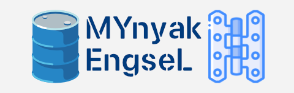

<p align="center">
  
</p>

<h1 align="center">⚡ Engsel (Go Edition) ⚡</h1>

<p align="center">
  <strong>Next-Generation High-Performance CLI Client for Indonesian Mobile Telco Ecosystem</strong>
</p>

<p align="center">
  <a href="https://github.com/tsaQB/engsel-go/actions/workflows/ci.yml"></a>
  <a href="https://github.com/tsaQB/engsel-go/releases"></a>
  <a href="https://golang.org"></a>
  <a href="LICENSE"></a>
  <a href="https://github.com/tsaQB"></a>
</p>

<p align="center">
  <a href="#-sekilas-tentang-engsel">Sekilas</a> •
  <a href="#-fitur-unggulan">Fitur Unggulan</a> •
  <a href="#-perbandingan-performa-python-vs-go">Performa</a> •
  <a href="#-instalasi--penggunaan">Instalasi</a> •
  <a href="#-arsitektur-proyek">Arsitektur</a> •
  <a href="#-konfigurasi-env">Konfigurasi</a> •
  <a href="#-disclaimer">Disclaimer</a>
</p>

---

## 📖 Sekilas Tentang Engsel

**Engsel (Go Edition)** adalah aplikasi CLI (*Command-Line Interface*) modern berbasis terminal yang ditulis ulang secara murni (**100% Native Go**) dari versi pendahulunya (*me-cli-sunset*).

Aplikasi ini dirancang khusus untuk memberikan pengalaman manajemen akun, paket kuota, transaksi (Pulsa, E-Wallet, QRIS langsung di terminal), hingga Family Plan/Circle dengan kecepatan maksimal, efisiensi memori luar biasa, serta tanpa dependensi runtime Python maupun library eksternal yang membengkak.

```
┌──────────────────────────────────────────────────────────┐
│  ENGSEL CLI v2.0  •  High-Performance Mobile Client      │
│  Designed for Termux, Linux, macOS, & Windows Terminal    │
│  Maintained by @tsaQB                                    │
└──────────────────────────────────────────────────────────┘
```

---

## ✨ Fitur Unggulan

| Fitur | Deskripsi |
| :--- | :--- |
| ⚡ **Performa Kilat** | Startup dingin dalam hitungan milidetik (< 50ms) dan konsumsi memori hemat (~12MB). |
| 📱 **Terminal QRIS Viewer** | Render QR Code QRIS langsung di konsol terminal ANSI dengan resolusi blok yang presisi. |
| 🔐 **Native Cryptography** | 100% kompatibel dengan algoritma enkripsi AES-CBC PKCS7, HMAC-SHA512/256 signature, CIAM, dan Circle MSISDN. |
| 👥 **Multi-Account Manager** | Simpan dan beralih di antara banyak nomor telepon dengan auto-refresh token JWT yang transparan. |
| 💳 **Metode Pembayaran Lengkap** | Mendukung Pulsa/Saldo, QRIS (Gopay, OVO, Dana, ShopeePay), dan penukaran voucher/redeem promo. |
| 👨‍👩‍👧‍👦 **Family Plan & Circle** | Kelola kuota anggota paket akrab, alokasi kuota per-anggota, hingga circle sharing. |
| 🎨 **Modern Dark Slate TUI** | Antarmuka interaktif 56-kolom responsif dengan palet warna TrueColor 24-bit yang nyaman di mata. |
| 📦 **Zero Runtime Dependencies** | Single executable binary mandiri tanpa perlu install Python, pip, GCC, atau runtime lainnya. |

---

## 📊 Perbandingan Performa: Python vs Go

| Metrik | Versi Python (*Legacy*) | Engsel Go (*v2.0+*) | Peningkatan |
| :--- | :--- | :--- | :--- |
| **Ukuran Memori (RAM)** | ~95 MB – 130 MB | **~12 MB – 18 MB** | 🟢 **Hemat ~85%** |
| **Cold Startup Time** | 1.8 detik – 3.2 detik | **< 0.04 detik** | 🟢 **50x Lebih Cepat** |
| **Crypto Throughput** | ~2,500 op/detik | **~140,000 op/detik** | 🟢 **56x Lebih Cepat** |
| **Kebutuhan Runtime** | Python 3, pip, OpenSSL, venv | **Single Static Binary** | 🟢 **Zero Dependency** |
| **Kompatibilitas Termux** | Butuh build environment | **Tinggal Unduh & Jalankan** | 🟢 **Instan** |

---

## 🚀 Instalasi & Penggunaan

### 1. Unduh Binary Siap Pakai (Rekomendasi untuk Termux & Desktop)

Unduh biner sesuai perangkat Anda di [GitHub Releases](https://github.com/tsaQB/engsel-go/releases):

| Platform / Arsitektur | Target Perangkat | Format Berkas |
| :--- | :--- | :--- |
| `linux-arm64` | **Android (Termux)**, Raspberry Pi 4/5, Server ARM64 | `.tar.gz` |
| `linux-amd64` | Ubuntu, Debian, Arch Linux, WSL, Server x86_64 | `.tar.gz` |
| `linux-armv7` | Router OpenWrt, Raspberry Pi 2/3, Embedded ARM 32-bit | `.tar.gz` |
| `windows-amd64` | Windows 10/11 64-bit | `.zip` |
| `darwin-arm64` | macOS Apple Silicon (M1/M2/M3/M4) | `.tar.gz` |
| `darwin-amd64` | macOS Intel | `.tar.gz` |

#### 📲 Contoh Cepat di Termux (Android):
```bash
# 1. Unduh biner rilis
curl -LO https://github.com/tsaQB/engsel-go/releases/latest/download/engsel-linux-arm64.tar.gz

# 2. Ekstrak arsip
tar -xzvf engsel-linux-arm64.tar.gz

# 3. Masuk ke direktori dan konfigurasi .env
cp .env.template .env
nano .env

# 4. Jalankan
./engsel
```

---

### 2. Kompilasi Sendiri dari Source Code (Bagi Pengembang)

Jika Anda memiliki compiler Go (1.22+):

```bash
# Clone repository
git clone https://github.com/tsaQB/engsel-go.git
cd engsel-go

# Konfigurasi file lingkungan
cp .env.template .env

# Jalankan langsung
go run main.go

# Atau kompilasi binary optimized (stripped symbol)
go build -ldflags="-s -w" -o engsel .
./engsel
```

---

## ⚙️ Konfigurasi (`.env`)

Salin file `.env.template` menjadi `.env` lalu lengkapi kunci-kunci berikut:

```env
BASE_API_URL=""
BASE_CIAM_URL=""
BASIC_AUTH=""
AX_FP_KEY=""
UA=""
API_KEY=""
ENCRYPTED_FIELD_KEY=""

XDATA_KEY=""
AX_API_SIG_KEY=""
X_API_BASE_SECRET=""
CIRCLE_MSISDN_KEY=""
```

> [!NOTE]
> Semua kredensial nomor telepon, token sesi aktif (`refresh-tokens.json`), dan sidik jari perangkat (`ax.fp`) akan disimpan secara lokal dan secara otomatis dikecualikan oleh `.gitignore` sehingga tidak akan bocor ke repositori Git.

---

## 📁 Arsitektur Proyek

Struktur kode dibangun dengan prinsip Clean Architecture dan modularitas tinggi:

```
engsel-go/
├── .github/
│   └── workflows/          # Otomasi CI testing & multi-arch cross-compilation
│       ├── ci.yml
│       └── release.yml
├── decoy_data/             # Payload template transaksi decoy
├── hot_data/               # Database katalog paket rekomendasi offline
├── internal/
│   ├── client/             # HTTP Client layer (API, CIAM, Store, Purchase, Family)
│   ├── config/             # Parser & validator file .env
│   ├── crypto/             # AES-CBC, PKCS7, HMAC, CIAM & Circle MSISDN crypto
│   ├── menu/               # Handler alur navigasi menu interaktif CLI
│   ├── service/            # Business logic: Auth, Bookmark, Decoy, Sentry
│   └── tui/                # Terminal UI engine, layout box, QR code terminal
├── .env.template           # Template konfigurasi variabel lingkungan
├── .gitignore              # Proteksi berkas privat dan binary
├── go.mod                  # Definisi Go module dependencies
├── go.sum                  # Checksum verifikasi modul
├── main.go                 # Entrypoint aplikasi utama
└── README.md               # Dokumentasi proyek
```

---

## 🛡️ Keamanan & Privasi

- **Local Storage Only**: Kredensial akun, nomor HP, dan token sesi hanya tersimpan di perangkat lokal Anda (`refresh-tokens.json`).
- **No Tracking**: Tidak ada analitik pihak ketiga atau pencatatan log jarak jauh.
- **Git-Ignored Defaults**: Berkas `.env`, token sesi, file backup, dan riwayat nomor telah diproteksi agar tidak pernah terunggah ke repositori publik.

---

## 📜 Disclaimer

Perangkat lunak ini dibuat semata-mata untuk tujuan riset, edukasi, dan kemudahan manajemen paket seluler pribadi pengguna melalui antarmuka baris perintah (*CLI*). 

Pengembang tidak bertanggung jawab atas segala bentuk penyalahgunaan, kerugian, atau pelanggaran ketentuan layanan pihak penyedia telekomunikasi terkait. Gunakan dengan bijak dan patuhi seluruh regulasi hukum yang berlaku.

---

## 👤 Author

Dikembangkan dan dipelihara oleh:

**Assaqib** ([@tsaQB](https://github.com/tsaQB))  
*Email*: `0xfiqks@gmail.com`  
*GitHub*: [https://github.com/tsaQB](https://github.com/tsaQB)

---

<p align="center">
  Dibuat dengan ❤️ menggunakan Go. Star ⭐ repositori ini jika bermanfaat!
</p>
